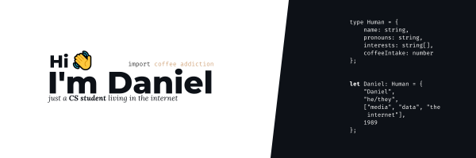

> ### Every action you take is a vote for the type of person you wish to become. 
> [James Clear, Atomic Habits](https://jamesclear.com/)
<br>

# 🥴 about me

- 💻 Pursuing **BS + MS in Computer Science** at De La Salle University, with my thesis in HCI (Human-X Interactions Lab)
- 🤖 **Building with Claude** most days: Claude Code for my thesis app, and my own skills and workflows for everything else
- 📚 **In love with information** from research to sharing insights
- 🙌 **In love with creating** from poetry to software
- ☕ **Coffee** is my water
- 📈 On my road to [✨ **eudaimonia** ✨](https://www.britannica.com/topic/eudaimonia)

```python 
# this is me trying
for day in range(0, 364): 
    self._health *= 1.01
    self._skills *= 1.01
    self._bad_habits *= 0.99
```

# ⚙️ danntraptions 

### Now
- 🔍 **Looking Glass** *(thesis, private for now)*: a PWA that shows people what their social media feed is showing them, using a multimodal LLM to turn screen recordings into structured posts. Built with Claude Code, 48 features in two months.
- 🗂️ [**scrollnotes**](https://github.com/dhannn/scrollnotes): a local-first research tool for annotating and curating social media posts into a reproducible dataset.
- 🔁 [**SD²R**](https://github.com/dhannn/sd2r-workflow-template): my way of learning with AI without just copying it. AI builds a throwaway prototype, I study it, then rebuild from my notes.

### AI and data
- 🧪 [**Synthetic training data with Claude**](https://github.com/dhannn/llm-synthetic-data-generation): can LLM-generated Taglish tweets help a hate-speech classifier? (Not here, and why.)
- 🕸️ [**Distributed scraper on Redis**](https://github.com/dhannn/distributed-scraper): explorer and extractor workers across machines, about 20x throughput. Paper included.
- 🧬 [**mimic-lang**](https://github.com/dhannn/mimic-lang): a type-safe DSL for agent-based modelling, in Rust.

### Earlier
- 📘 [**Coursify**](https://github.com/dhannn/coursify): generates a self-directed learning plan from your goals and time.
- 📷 [**Pickt**](https://github.com/dhannn/pickt-app): a forum for photographers, client and server built solo (React, Express, MongoDB).
